# RFC 5979 router walkthrough: from the token view to the expert view

This is a visual companion to [RFC 5979](5979-MoESparseComputeRFC.md), Path A (chunked prefill). It follows the router ops A11 to A17w and one tile of the routed-expert loop A21t to A32 on a toy routing, with every tensor drawn as sticks. Op numbers, shapes and precisions are the RFC's.

Sizes are per prefill chunk: `Tq` = 8192 tokens through the router and expert loop of one MoE layer, with `E` = 128 experts, `K` = 8 experts per token and tiles of `G` = 512 slots. The toy uses `Tq` = 8, `E` = 4, `K` = 2, `G` = 4, and draws a stick with 4 lanes (a real stick holds 32 fp32/int32 or 64 df16 elements).

## The two views

The router produces a token view: for each token, its `K` experts and their weights. The expert loop needs an expert view: for each expert, the tokens routed to it, padded to tiles of `G`. How many tokens an expert gets is data-dependent, anywhere from 0 to `Tq`; in the toy below it is 7, 4, 5 and 0.

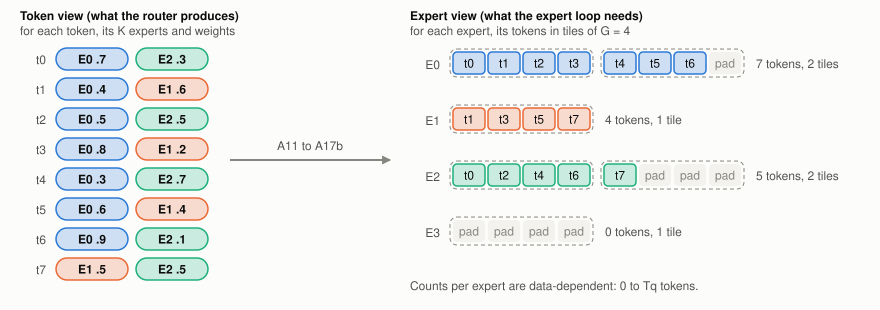

## The whole-stick rule

Gathers and scatters move whole sticks. An element that has to be placed on its own must first fill a stick, so it is replicated across a dummy dim. Two broadcast reads appear in the router: scale −1 reuses a whole stick along a dim the operand does not have, and scale −2 spreads lane 0 of a sparse stick across all lanes. The index-to-address conversions (`idx2Addr`) are not ops of the frontend: the backend inserts each one right in front of the gather, scatter or indirect access that consumes it. They are drawn dashed throughout and named after their consumer with an `i` suffix.

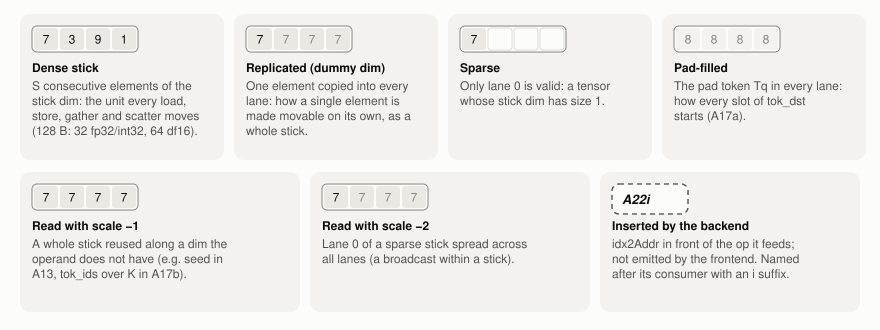

## Dataflow

The router runs once per prefill chunk. Its outputs feed the expert loop: `tok_dst` (the expert-major token lists), `w_dummy` (the routing weights as one stick per (token, expert)), `x_pad`, `moe_out` and the loop bound `nc[e]`.

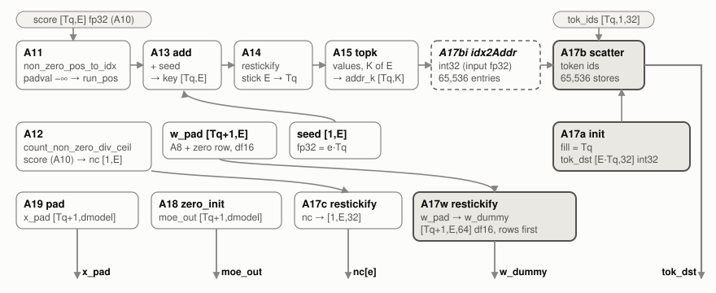

The loop runs once per tile of each expert. The tile's token ids `tok` go directly to the gathers and the scatter; the backend inserts one conversion of the tile's `G` ids in front of each of them.

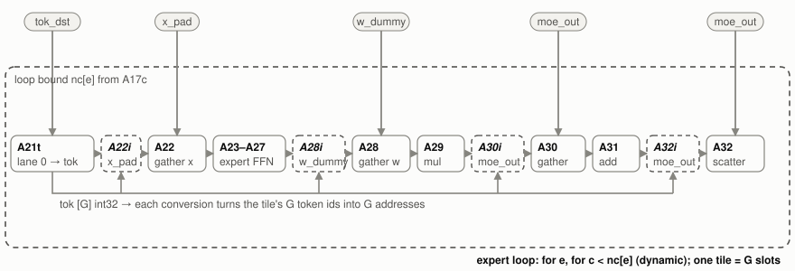

## Router, step by step

### A11 and A13: every entry's address in the expert-major list

A11 `non_zero_pos_to_idx` scans `score` along `Tq`, independently per expert lane, and gives each selected entry its slot in the expert's list. Entries that are not selected get `padval` = −∞. A13 adds the constant `seed` = `e·Tq`, broadcast over `Tq` (a scale −1 read), so `key = e·Tq + slot` is the entry's address in one expert-major list of `E·Tq` slots. −∞ stays −∞, so A15 can never pick an unselected entry; this is why `padval` must be −∞. `key` is exact in fp32 (at most `E·Tq` = 1,048,576 < 2²⁴).

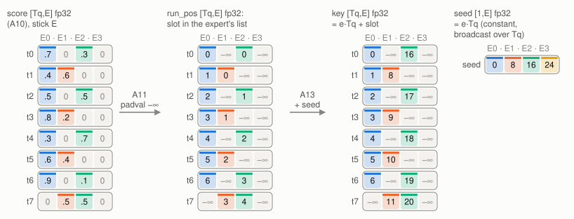

### A14 and A15: from the token view to the expert view

A14 restickifies `key` so that `E` runs across sticks, as A3 does before A4. A15 `topk` (values, `K`, dim `E`) then keeps, for each token, its `K` finite keys: exactly the addresses of its selected entries. Their order within a token does not matter. `addr_k [Tq, K]` fp32 is the token view of where each entry goes in the expert view.

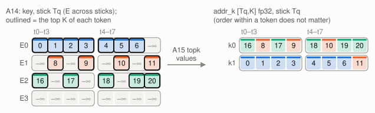

### A17a: every slot starts as the pad token

A17a initializes the expert-major list `tok_dst [E·Tq, 32]` int32: slot `s` of expert `e` is row `e·Tq + s`, and every slot holds the pad token `Tq`. Slots past `cnt[e]` therefore need no masking later. The RFC recommends a broadcast copy of a `[1,32]` constant (one device kernel). At real size the list is 128 MB.

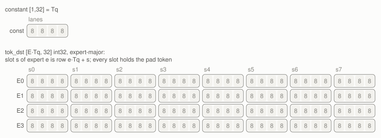

### A17bi and A17b: one stick store per real (token, expert) pair

A17b scatters the token ids into `tok_dst`, with `addr_k` (A15) as its index. Each stored element must be a whole stick, so the source is the constant `tok_ids [Tq, 1, 32]` int32, the token id replicated in its own stick and broadcast over `K`. In front of A17b the backend inserts A17bi, which converts `addr_k` into stick addresses: `Tq·K` = 65,536 entries, int32 output from an fp32 input. A17b makes one store per real (token, expert) pair, 65,536 stores at real size, none into a sink. Slots it does not write keep the pad token from A17a.

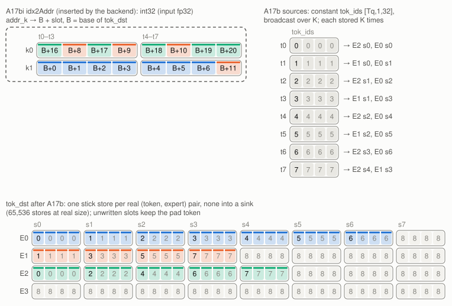

### A17c: the loop bound

A12 `count_non_zero_div_ceil` counts the tokens of each expert and gives the number of tiles `nc[e] = max(1, ⌈cnt[e]/G⌉)`. A count of 0 gives 1, so every expert runs at least one tile (an all-pad tile for an unused expert). A17c restickifies `nc [1, E]` to `[1, E, 32]`: one stick per expert, the source of the dynamic bound of the tile loop.

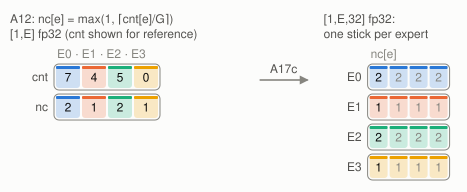

### A17w: routing weights as one stick per (token, expert)

A17w restickifies `w_pad [Tq+16, E]` df16 (A8 with 16 zero rows appended; row `Tq` is the pad token's zero row) into `w_dummy [Tq+16, E, 64]` df16: one replicated stick per (token, expert) weight, rows outermost. The loop can then fetch a token's weight for expert `e` as a single stick by token id (A28). Appending 16 rows rather than 1 keeps the work split evenly over all cores; rows past `Tq` are never read. The toy draws only the pad row `Tq`.

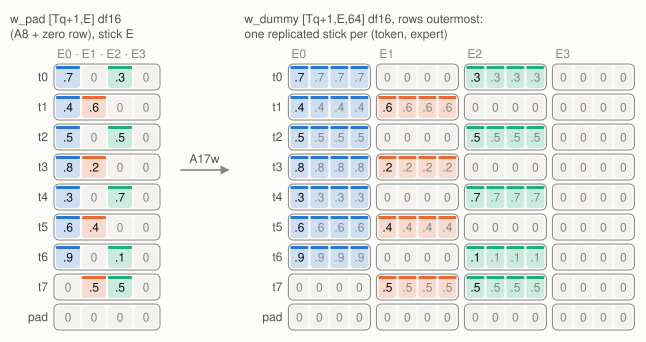

## Expert loop, one tile

### A21t: the tile's token ids

Tile `c` of expert `e` is slots `[c·G, (c+1)·G)`, rows `[e·Tq + c·G, +G)` of `tok_dst`: contiguous and stick-aligned, since `G` is a multiple of the stick. A21t restickifies the tile's lane 0 into `tok [G]` int32. Slots past `cnt[e]` already hold the pad token, so `tok` is used as is. In the toy, tile 1 of expert E0 gives `tok` = 4, 5, 6, 8.

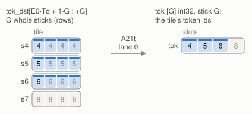

### A22, A28, A30, A32: the indirect accesses

A22, A28, A30 and A32 take `tok` directly. The backend inserts one conversion in front of each: A22i (base `x_pad`), A28i (the address of `w_dummy[tok, e]`: row `tok`, expert `e`), A30i and A32i (base `moe_out`). Each converts one tile, `tok [G]` int32 to `[G]` int32, `G` = 512 entries at real size. A28 gathers `G` single sticks `w_dummy[tok, e]` from `w_dummy [Tq+16, E, 64]`: `w_tile [G, 64]`, the token's weight for expert `e`, already replicated across the stick, which A29 multiplies into each token's `dmodel` sticks. The pad token reads the zero row `Tq` of `x_pad` and writes the sink row `Tq` of `moe_out`, so its results are discarded.

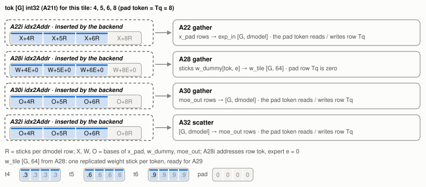

## Index-to-address conversions at a glance

| Conversion | In front of | Input | Output | Entries | Runs |
|---|---|---|---|---|---|
| A17bi | A17b (scatter) | `addr_k [Tq, K]` fp32 (A15) | `[Tq, K]` int32 (input fp32) | `Tq·K` = 65,536 | once per prefill chunk |
| A22i | A22 (gather `x_pad`) | `tok [G]` int32 (A21t) | `[G]` int32 | `G` = 512 | per tile |
| A28i | A28 (gather `w_dummy[tok, e]`) | `tok [G]` int32 (A21t) | `[G]` int32 | `G` = 512 | per tile |
| A30i | A30 (gather `moe_out`) | `tok [G]` int32 (A21t) | `[G]` int32 | `G` = 512 | per tile |
| A32i | A32 (scatter `moe_out`) | `tok [G]` int32 (A21t) | `[G]` int32 | `G` = 512 | per tile |

All of them are inserted by the backend; the frontend emits the gathers and scatters with their index tensors.
